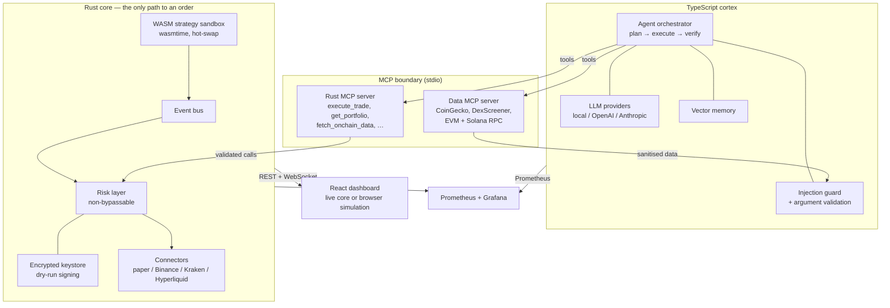
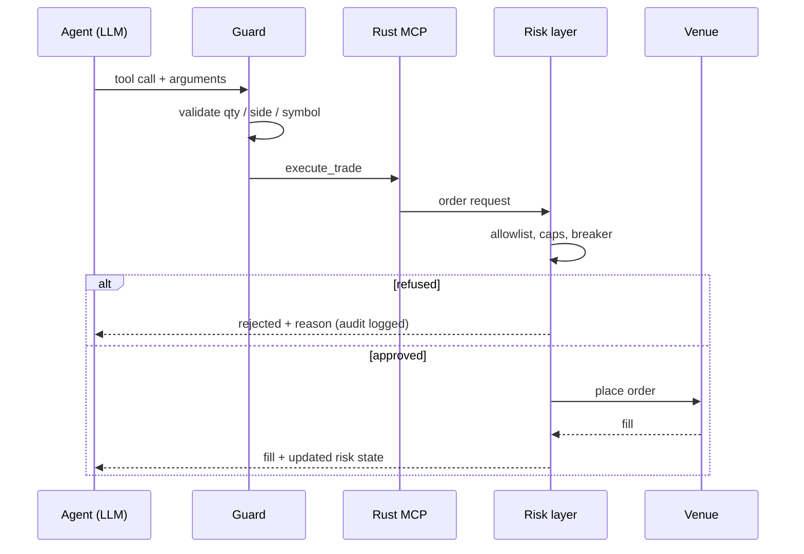

# openEther

An autonomous crypto trading agent with a **non-bypassable risk layer**.

A Rust core owns every order. A TypeScript agent reasons, plans and calls tools —
but it cannot place an order that the Rust risk layer refuses. The dashboard
runs the same rules in the browser so the public demo is tradeable without a
backend.

> **Live demo:** <https://antontuzov.github.io/openether>
> The hosted site is a **simulation**. It prices 50 markets from the free
> CoinGecko feed and fills locally in your browser. No exchange account, no
> keys, no real orders.

---

## Safety first

Read this before running anything.

- **Paper by default.** `OPENETHER_LIVE_TRADING=0` and `OPENETHER_VENUE=paper`.
  Orders go to a deterministic simulated venue.
- **No broadcast path exists.** The wallet signs and logs; it never sends a
  transaction. `dry_run` is `true` and `broadcast` is `false` in every response,
  and the API refuses to sign at all if dry run is switched off.
- **The risk layer is absolute.** The agent has no tool, flag or prompt that
  reaches around it. See [Risk layer](#risk-layer).
- **Keys are never hardcoded.** The keystore is AES-256-GCM with an
  Argon2id-derived key. The passphrase is supplied per request, held only for
  the signing call, and zeroized afterwards.
- **The admin gate is not authentication.** The published dashboard is a static
  site. Its password gate keeps casual visitors out of the analytics view; it
  is *not* a substitute for keeping a real engine on a private network.

This software trades nothing by default and is provided for research and
education. It is **not financial advice**. Crypto trading can lose you all of
your capital. You are responsible for any credentials you configure and any
orders you enable. See [Disclaimer](#disclaimer).

---

## Architecture



The order path is deliberately one-way:



### Layout

```
rust/
  crates/core/            engine, bus, risk, wallet, connectors, HTTP/WS API
  crates/mcp-server/      MCP stdio server exposing core functions as tools
  crates/strategies/      momentum strategy, compiled to wasm32
ts/
  packages/agent/         orchestrator, LLM providers, guard, memory, metrics
  packages/mcp-data/      market + on-chain MCP server (9 tools)
  packages/ui/            React dashboard + browser paper-trading engine
deploy/                   Prometheus config, Grafana dashboard
scripts/                  native run scripts (no Docker)
docs/api-contract.md      wire contract shared by the core and the dashboard
```

---

## Quick start

No Docker. You need **Rust 1.85+**, **Node 20.19+** and **pnpm 12**.

```bash
git clone https://github.com/antontuzov/openether.git
cd openether
cp .env.example .env
pnpm --dir ts install
```

### 1. Just the dashboard

```bash
./scripts/run-ui.sh          # http://127.0.0.1:5173
```

With no core running, the dashboard falls back to its **browser simulation**:
50 live markets, a trade ticket, the full risk layer, portfolio, positions and
the admin analytics — all client-side, persisted to `localStorage`.

### 2. The real engine

```bash
./scripts/run-core.sh        # paper venue on 127.0.0.1:8080
./scripts/run-ui.sh          # dashboard now talks to the core
```

Or both at once:

```bash
./scripts/dev.sh
```

### 3. The agent

```bash
./scripts/run-agent.sh
```

`LLM_PROVIDER=local` is the default: a deterministic offline planner that needs
no API key and still exercises the whole tool path and the risk layer. Set
`LLM_PROVIDER=openai` or `anthropic` with the matching key for a real model.

### 4. The WASM strategy

```bash
./scripts/build-strategy.sh
```

That writes `rust/target/wasm/momentum.wasm`, which is the path `.env.example`
already points `OPENETHER_STRATEGY_WASM` at. Strategies are sandboxed with fuel
and memory limits and can be hot-swapped at runtime via
`POST /api/strategy/reload` — no core rebuild.

### Tests

```bash
cargo test --workspace --manifest-path rust/Cargo.toml   # 84 tests
pnpm --dir ts -r test                                    # 92 tests
pnpm --dir ts -r typecheck
pnpm --dir ts -r build
```

---

## Risk layer

Every order passes the same checks, in the Rust core and in the browser
simulation. The agent cannot skip them.

| Limit | Default | Rejection reason |
| --- | --- | --- |
| Single order notional | $5,000 | `above_max_notional` |
| Minimum order notional | $10 | `below_min_notional` |
| Position size | 20% of equity | `position_cap` |
| Gross exposure | 60% of equity | `gross_exposure_cap` |
| Open positions | 5 | `max_open_positions` |
| Free cash | margin-aware | `insufficient_cash` |
| Daily loss | 3% | trips the breaker |
| Drawdown from peak | 10% | trips the breaker |
| Symbol / venue / contract | allowlist | `unknown_symbol` |
| Sells | reduce-only | `no_position`, `reduce_only` |

**The circuit breaker** opens on a daily-loss or drawdown breach and refuses
every subsequent order (`breaker_open`) until it is explicitly reset. A reset
always requires `{"confirm": true}` on `POST /api/breaker/reset` — there is no
configuration switch for it, so the agent cannot reset the breaker on its own.
Half-open states allow only a probe order. Every decision is written to an audit
ring buffer exposed at `GET /api/risk/decisions`.

### Paper accounting

The paper venue is a USD-margined account, so `equity = cash + unrealized PnL`
holds literally: opening a position **locks margin** (`|qty| × avg_entry`)
rather than spending cash. Only fees and realised PnL move the wallet balance.
The browser engine mirrors this exactly — buying $1,000 of SOL costs you the
fee, not $1,000 of equity.

---

## Dashboard

- **Two themes.** Every colour is a CSS custom property; the light theme
  overrides the same token names. Both themes pass WCAG AA contrast for text.
- **Core / simulator tabs.** The dashboard auto-selects the simulator when no
  core is reachable, so the published site is never a dead page.
- **Trade ticket** with live notional, cap preview and the exact rejection
  reason from the risk layer.
- **Markets**: top 50 coins by market cap from the free CoinGecko endpoint,
  filterable and sortable, each with a trade button.
- **Admin analytics** (password-gated): net/gross P&L, fees, win rate, profit
  factor, equity curve, P&L by bucket, and a pivot table across symbol, venue,
  side, day, hour and source.

### Enabling the admin panel

The gate compares a SHA-256 digest computed in the browser against a digest
baked in at build time. **The password itself is never shipped.** With no
digest configured the panel stays permanently locked.

```bash
printf '%s' 'your-password' | shasum -a 256
```

Put the digest in `.env` as `VITE_ADMIN_PASSWORD_HASH` and rebuild. For the
hosted site, set it as the `ADMIN_PASSWORD_HASH` repository secret; the Pages
workflow passes it into the build.

This is a gate, not access control. Anyone can read the bundle. Never put
anything sensitive behind it.

---

## MCP tools

**Rust core** (`rust/crates/mcp-server`): `execute_trade`, `get_portfolio`,
`get_positions`, `get_trade_history`, `get_risk_state`, `get_market_data`,
`get_agent_logs`, `fetch_onchain_data`.

**Market + on-chain** (`ts/packages/mcp-data`): `list_top_coins`,
`get_coin_price`, `get_coin_details`, `search_dex_pairs`, `get_dex_liquidity`,
`get_token_metadata`, `get_evm_balances`, `get_evm_tx_history`,
`get_solana_balances`.

All of these run on free, keyless endpoints by default (CoinGecko, DexScreener,
public EVM and Solana RPC). Etherscan is optional. Responses are cached,
rate-limited and sanitised before they reach the model.

### Prompt-injection defence

Tool output is untrusted data. Before it reaches a prompt it is stripped of
ANSI and control characters, screened for injection patterns (instruction
overrides, persona replacement, role tags, approval bypass), truncated, and any
contract address outside the allowlist is redacted. Separately, the arguments
the model wants to send are validated before the call runs — and the Rust core
validates them again, because the TypeScript layer is not trusted either.

---

## Observability

Both layers export Prometheus metrics: the core on `:8080/metrics`, the agent
on `:9090/metrics`.

```bash
prometheus --config.file=deploy/prometheus.yml
```

Import `deploy/grafana/openether-dashboard.json` into Grafana. It covers equity,
PnL, event-bus dispatch latency (p50/p99 against the <10µs target), the order
funnel, drawdown, breaker state, risk rejections, LLM latency and strategy
ticks/errors.

---

## Hosting

The dashboard is a static bundle, so GitHub Pages hosts it for free at
`https://<user>.github.io/<repo>/` — no domain purchase, no DNS, no expiry.

This repo is published at **https://antontuzov.github.io/openether/**.

A published page has no Rust core behind it. The dashboard detects that on
boot and switches itself to the **simulator**, so a visitor gets a working
paper-trading terminal rather than an empty screen: 50 markets priced from the
free CoinGecko feed, the same risk caps, and fills persisted to `localStorage`.
Nothing there is real money and no keys are involved.

`.github/workflows/pages.yml` builds and deploys on every push to `main`.
Vite uses `base: '/openether/'` for production builds and `/` in dev; override
with `VITE_BASE_PATH` for a custom domain.

To publish your own fork:

1. Create a **public** repository (Pages requires it on the free plan).
2. Push to `main`.
3. Settings → Pages → Source: **GitHub Actions**.
4. Optionally add the `ADMIN_PASSWORD_HASH` secret.

---

## Configuration

Copy `.env.example` to `.env`. The important defaults:

| Variable | Default | Meaning |
| --- | --- | --- |
| `OPENETHER_LIVE_TRADING` | `0` | master switch for real orders |
| `OPENETHER_VENUE` | `paper` | `paper` / `binance` / `kraken` / `hyperliquid` (read-only) |
| `OPENETHER_WALLET_DRY_RUN` | `1` | sign and log, never broadcast |
| `OPENETHER_SYMBOL_ALLOWLIST` | `SOL/USDT,BTC/USDT,ETH/USDT` | tradable symbols |
| `OPENETHER_CONTRACT_ALLOWLIST` | *(empty)* | permitted on-chain contracts |
| `LLM_PROVIDER` | `local` | `local` / `openai` / `anthropic` / `openai-compatible` |
| `VITE_ADMIN_PASSWORD_HASH` | *(empty)* | build-time admin gate digest |

Exchange credentials are only read when `OPENETHER_LIVE_TRADING=1`. `.env`,
`*.keystore` and `*.key` are gitignored.

### HTTP API

`GET /healthz`, `/metrics`, `/api/config`, `/api/portfolio`, `/api/positions`,
`/api/trades`, `/api/logs`, `/api/ticks`, `/api/risk`, `/api/risk/decisions`,
`/api/strategy`, `/api/venues`, `/api/wallet`;
`POST /api/orders`, `/api/logs`, `/api/onchain`, `/api/strategy/reload`,
`/api/breaker/reset`, `/api/wallet/sign-dry-run`;
`GET /ws` for the live stream. Full shapes in [docs/api-contract.md](docs/api-contract.md).

---

## What is verified

Checked locally on macOS (arm64):

- `cargo test --workspace` — **84 passing**, including the encrypted keystore,
  EVM and Solana dry-run signing, signature tampering, wrong-passphrase
  rejection, and the API refusing to sign when dry run is off.
- `cargo fmt --check` and `cargo clippy --workspace --all-targets -- -D warnings`
  — clean, so the CI gate passes as written.
- `pnpm -r test` — **92 passing** across the agent guard, the data server and
  the browser trading engine.
- `pnpm -r typecheck` and `pnpm -r build` — clean.
- Dashboard exercised in a real browser: an oversized BTC order rejected with
  the notional cap reason, a within-limits SOL order filled, the position cap
  enforced on adding, a closing sell settling exactly two fees, the breaker
  blocking every order once open, both themes, and the admin gate rejecting a
  wrong password and unlocking on the right one.
- Contrast audited programmatically across every text node in both themes,
  including the breaker-open alarm state — no WCAG AA failures.
- The core run locally in paper mode with the WASM strategy loaded: an
  oversized BTC order refused with `notional_too_large`, DOGE refused with
  `symbol_not_allowed`, a 2 SOL round trip charging 5 bps per side and booking
  the realized PnL, and equity reconciling to the cent
  (`10000 − fees + realized`).
- The **published** site exercised in a real browser with no core running: it
  falls back to the simulator on its own, prices 50 markets from the free
  CoinGecko feed, refuses a 0.05 BTC order with the 20% position cap, fills
  0.02 BTC while locking margin and charging exactly one fee, and persists to
  `localStorage`. The admin gate rejects a wrong password and unlocks on the
  right one, revealing the pivot table and charts.
- Contrast re-audited on the deployed bundle in both themes — 855 visible text
  nodes each, zero WCAG AA failures.

**Not verified:** live exchange connections (no credentials were used), real
on-chain transactions (no broadcast path exists), and the <10µs dispatch target
on your hardware. Grafana and Prometheus configs are provided but were not run
against a live scrape here.

Bugs found and fixed during that verification:

- The browser ticket read its result out of a deferred React state updater, so
  every order reported "not executed" even when it filled.
- The browser engine spent cash instead of locking margin, which tripped the
  breaker on the first ordinary buy. Now covered by the accounting tests.
- Vite's `envDir` pointed at `ts/` rather than the repo root, so the admin
  password hash was never loaded.
- The injection guard filtered only the first occurrence of a pattern. Now
  covered by the guard tests.
- Nothing read `.env`, despite these instructions. `scripts/load-env.sh` now
  loads it for all three run scripts, without executing values that contain
  spaces.
- The WASM memory cap defaulted to 16 pages, but a Rust `wasm32` guest declares
  a 17-page minimum, so the shipped strategy never loaded. The default is now
  32 pages, with a regression test.
- The paper connector never implemented `fills_since`, so the engine fell back
  to a synthetic fill: every paper trade reported a **zero fee** and no
  slippage, disagreeing with the venue's own account. Now covered by a test.
- The engine's trade records hardcoded `realized_pnl: 0.0` even though the
  value was computed, which would have broken win-rate and profit-factor
  analytics.
- The price walk added a *dollar* gap to a *fractional* return, so mean
  reversion multiplied the price instead of nudging it — a 94% jump in one
  tick. Now covered by a test.
- `.env.example` documented `OPENETHER_PAPER_START_EQUITY` (the code reads
  `OPENETHER_PAPER_CASH`), a `HYPERLIQUID_PRIVATE_KEY` nothing reads (that
  connector is read-only), and an `OPENETHER_BREAKER_RESET_CONFIRM` switch that
  does not exist — reset confirmation is unconditional and cannot be disabled.
- `CORE_MCP_ARGS` used a manifest path relative to the repo root, but pnpm runs
  the agent from `ts/packages/agent`, so the MCP server could not start.
- The admin equity curve needs two points to draw, but with exactly one fill it
  said "no fills to plot yet" beside a badge reading "1 fills". Both now
  describe what is on screen.

---

## Disclaimer

This project is for research and education. It is not financial advice, not a
recommendation to trade, and not a production trading system. Automated trading
can lose money rapidly and completely. Markets are volatile, APIs fail, models
hallucinate, and risk limits reduce but never eliminate loss.

The authors accept no liability for any financial loss, lost keys, or damage
arising from use of this software. If you enable live trading you do so entirely
at your own risk. Never commit private keys. Never fund a wallet you cannot
afford to lose. Start in paper mode and stay there until you understand every
order the agent produces.

## License

MIT — see [LICENSE](LICENSE).