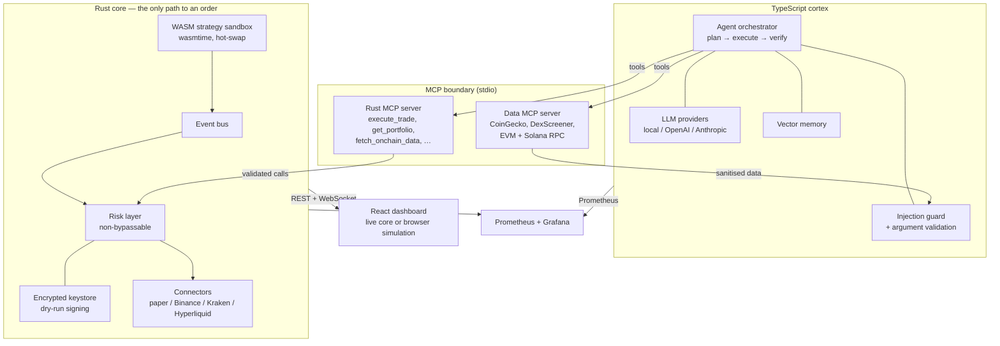
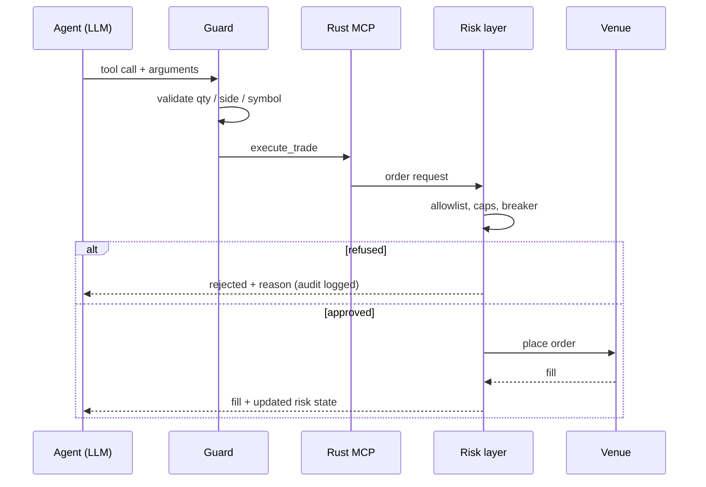

# openEther

An autonomous crypto trading agent with a **non-bypassable risk layer**.

A Rust core owns every order. A TypeScript agent reasons, plans and calls tools —
but it cannot place an order that the Rust risk layer refuses. The dashboard
runs the same rules in the browser so the public demo is tradeable without a
backend.

> **Live demo:** <https://antontuzov.github.io/openether>
> The hosted site is a **simulation**. It prices 50 markets from the free
> CoinGecko feed and fills locally in your browser. No exchange account, no
> keys, no real orders.

---

## Safety first

Read this before running anything.

- **Paper by default.** `OPENETHER_LIVE_TRADING=0` and `OPENETHER_VENUE=paper`.
  Orders go to a deterministic simulated venue.
- **Live trading needs a ceremony, not a flag.** The environment variable only
  asks for live trading. The core also needs a valid, expiring arming record
  that the operator wrote from the CLI. See
  [Live trading](#live-trading).
- **No broadcast path exists.** The wallet signs and logs; it never sends a
  transaction. `dry_run` is `true` and `broadcast` is `false` in every response,
  and the API refuses to sign at all if dry run is switched off.
- **The risk layer is absolute.** The agent has no tool, flag or prompt that
  reaches around it. See [Risk layer](#risk-layer).
- **Protective exits live at the venue, not in the agent's head.** A stop or
  take-profit is a reduce-only order the venue holds and fires from its own
  price feed, so the exit survives a core restart, and the risk layer refuses a
  conditional order that could open a position or fire on arrival.
- **Keys are never hardcoded.** The keystore is AES-256-GCM with an
  Argon2id-derived key. The passphrase is supplied per request, held only for
  the signing call, and zeroized afterwards.
- **The admin gate is not authentication.** The published dashboard is a static
  site. Its password gate keeps casual visitors out of the analytics view; it
  is *not* a substitute for keeping a real engine on a private network.

This software trades nothing by default and is provided for research and
education. It is **not financial advice**. Crypto trading can lose you all of
your capital. You are responsible for any credentials you configure and any
orders you enable. See [Disclaimer](#disclaimer).

---

## Architecture



The order path is deliberately one-way:



### Layout

```
rust/
  crates/core/            engine, bus, risk, wallet, connectors, HTTP/WS API
  crates/mcp-server/      MCP stdio server exposing core functions as tools
  crates/strategies/      momentum strategy, compiled to wasm32
ts/
  packages/agent/         orchestrator, LLM providers, guard, memory, metrics
  packages/mcp-data/      market + on-chain MCP server (9 tools)
  packages/ui/            React dashboard + browser paper-trading engine
deploy/                   Prometheus config, Grafana dashboard
scripts/                  native run scripts (no Docker)
docs/api-contract.md      wire contract shared by the core and the dashboard
```

---

## Quick start

No Docker. You need **Rust 1.85+**, **Node 20.19+** and **pnpm 12**.

```bash
git clone https://github.com/antontuzov/openether.git
cd openether
cp .env.example .env
pnpm --dir ts install
```

### 1. Just the dashboard

```bash
./scripts/run-ui.sh          # http://127.0.0.1:5173
```

With no core running, the dashboard falls back to its **browser simulation**:
50 live markets, a trade ticket, the full risk layer, portfolio, positions and
the admin analytics — all client-side, persisted to `localStorage`.

### 2. The real engine

```bash
./scripts/run-core.sh        # paper venue on 127.0.0.1:8080
./scripts/run-ui.sh          # dashboard now talks to the core
```

Or both at once:

```bash
./scripts/dev.sh
```

### 3. The agent

```bash
./scripts/run-agent.sh
```

`LLM_PROVIDER=local` is the default: a deterministic offline planner that needs
no API key and still exercises the whole tool path and the risk layer. Set
`LLM_PROVIDER=openai` or `anthropic` with the matching key for a real model.

### 4. The WASM strategy

```bash
./scripts/build-strategy.sh
```

That writes `rust/target/wasm/momentum.wasm`, which is the path `.env.example`
already points `OPENETHER_STRATEGY_WASM` at. Strategies are sandboxed with fuel
and memory limits and can be hot-swapped at runtime via
`POST /api/strategy/reload` — no core rebuild.

### Tests

```bash
cargo test --workspace --manifest-path rust/Cargo.toml   # 185 tests
pnpm --dir ts -r test                                    # 127 tests
pnpm --dir ts -r typecheck
pnpm --dir ts -r build
```

---

## Risk layer

Every order passes the same checks, in the Rust core and in the browser
simulation. The agent cannot skip them.

### One source of truth

The Rust core owns the limits, the order the checks run in and the words an
order is refused with. The dashboard reads that contract instead of keeping a
copy of it:

```bash
# The contract the engine is running with, as JSON.
curl -s http://localhost:8080/api/risk/rules

# The same contract, generated for the browser.
cargo run -p openether-core --bin openether-rules
```

The second command writes the file the dashboard falls back on when no core is
reachable (`ts/packages/ui/src/lib/risk-rules.json`). It is generated, not
hand-written, and a Rust test fails the build when the two drift apart.

The checks run in this order, and the first one that fails is the reason the
order is refused:

| # | Check | Reason code |
| --- | --- | --- |
| 1 | The breaker is closed | `breaker_open` |
| 2 | The size is a positive number | `invalid_quantity` |
| 3 | The price is known and positive | `invalid_price` |
| 4 | A conditional order has a real trigger | `invalid_trigger` |
| 5 | That trigger is still ahead of the market | `trigger_already_crossed` |
| 6 | A conditional order only reduces a position | `conditional_not_reduce_only` |
| 7 | The equity is known | `invalid_equity` |
| 8 | The symbol is not empty | `invalid_symbol` |
| 9 | The symbol is on the allowlist | `symbol_not_allowed` |
| 10 | The venue is on the allowlist | `venue_not_allowed` |
| 11 | The contract is on the allowlist | `contract_not_allowed` |
| 12 | The order is large enough | `notional_too_small` |
| 13 | The order is under the per-order cap | `notional_too_large` |
| 14 | The sell does not flip the position | `reduce_only_violation` |
| 15 | The position is under the size cap | `position_size_exceeds_max_pct` |
| 16 | The book is under the gross cap | `gross_exposure_exceeded` |
| 17 | There is room for another position | `max_open_positions` |
| 18 | The probe order is small enough | `half_open_probe_too_large` |

The venue then applies its own rules on top: `no_position` when there is
nothing to sell, `reduce_only` when the sell would flip the position, and
`insufficient_cash` when the free cash is short. An order that passes
everything is `approved`.

| Limit | Default | Rejection reason |
| --- | --- | --- |
| Single order notional | $5,000 | `notional_too_large` |
| Minimum order notional | $10 | `notional_too_small` |
| Position size | 20% of equity | `position_size_exceeds_max_pct` |
| Gross exposure | 60% of equity | `gross_exposure_exceeded` |
| Open positions | 5 | `max_open_positions` |
| Free cash | margin-aware | `insufficient_cash` |
| Daily loss | 3% | trips the breaker |
| Drawdown from peak | 10% | trips the breaker |
| Symbol / venue / contract | allowlist | `symbol_not_allowed` |
| Sells | reduce-only | `no_position`, `reduce_only` |

**The circuit breaker** opens on a daily-loss or drawdown breach and refuses
every subsequent order (`breaker_open`) until it is explicitly reset. A reset
always requires `{"confirm": true}` on `POST /api/breaker/reset` — there is no
configuration switch for it, so the agent cannot reset the breaker on its own.
Half-open states allow only a probe order. Every decision is written to an audit
ring buffer exposed at `GET /api/risk/decisions`.

An order that breaks the position cap also opens the breaker, so a single
oversized order halts trading instead of being refused once.

### The browser simulation

The simulator in the dashboard is a second venue. It runs the engine's limits,
the engine's check order and the engine's reason codes, so it refuses exactly
what the engine refuses, for the same reason. Two things differ, both on
purpose:

- **The allowlists are cleared.** They describe the engine's own venue — which
  symbols its connectors may trade on a live account. The simulator has no
  exchange account, so it trades every market the free price feed offers.
- **No keys, no orders.** Fills are computed in the browser. Nothing reaches an
  exchange.

### Paper accounting

The paper venue is a USD-margined account, so `equity = cash + unrealized PnL`
holds literally: opening a position **locks margin** (`|qty| × avg_entry`)
rather than spending cash. Only fees and realised PnL move the wallet balance.
The browser engine mirrors this exactly — buying $1,000 of SOL costs you the
fee, not $1,000 of equity.

### Durable state

The core keeps its risk-relevant state in a SQLite database so a restart is not
a way around the risk layer. Set `OPENETHER_STATE_DB` to a path and the engine
writes there:

```bash
OPENETHER_STATE_DB=./data/openether.db
```

It stores the portfolio (equity, cash, realised P&L), the open positions, the
full trade journal, the open orders, the client-order-id → venue-order-id
mapping, and the circuit-breaker state.

Three details matter:

- **A breaker that was open stays open.** Restarting does not close it.
- **The risk layer restores its own position map**, not just the engine's. The
  gross-exposure cap is measured from that map, so without it a restarted
  process would believe it holds nothing and open a fresh full-size position.
- **The venue gets its account back.** A live exchange re-reports its balances
  on every poll, but the simulator has no server to ask — so the engine hands
  it the persisted cash, realised P&L and positions. Without that the engine
  would believe it held a position while the simulator believed it held cash,
  and the two would disagree about every margin calculation.

The state is written on every fill, so a crash loses at most the trade in
flight.

Leaving the variable unset (or set to `memory`) keeps everything in RAM. That is
fine for a throwaway demo and **wrong for a live run**: equity would reset to
zero and every limit would re-open.

---

## Live trading

Live trading is not a flag. `OPENETHER_LIVE_TRADING=1` only says *"I would like
to trade live"* — on its own it arms nothing and the core stays on paper.

Two things are needed, and the core refuses to trade unless **both** are true:

1. `OPENETHER_LIVE_TRADING=1` — the operator asks for live trading.
2. A valid **arming record** at `OPENETHER_LIVE_ARMING_FILE` — the operator
   proves they meant it.

The record is written by the `openether-live` CLI, never over HTTP. Run this
from the repository root and use an absolute path for the record, so the CLI
and the core agree on where it is:

```bash
cargo build --release --manifest-path rust/Cargo.toml

export OPENETHER_LIVE_ARMING_FILE="$PWD/data/live-arming.json"

# See what the core would do right now.
./rust/target/release/openether-live status

# Arm it. The CLI prints the limits it is about to run under and then demands
# the confirmation phrase on stdin.
printf 'I UNDERSTAND THIS SENDS REAL ORDERS\n' | \
  ./rust/target/release/openether-live arm \
    --venue binance --max-notional 500 --hours 4 --note "morning session"

# Run the core with OPENETHER_LIVE_TRADING=1 and that arming file.
OPENETHER_LIVE_TRADING=1 ./scripts/run-core.sh

# Turn it off again. This is the only way to disarm.
./rust/target/release/openether-live disarm
```

### What the record binds

The arming is a record, not a permission slip you can copy around:

| Property | Rule |
| --- | --- |
| Venue | The record names one venue. The core must run on that venue. |
| Expiry | It expires (default 4 hours, maximum 30 days). |
| Config binding | It carries a SHA-256 digest of the risk configuration it was written against. Change a limit and the arming is stale. |
| Direction | It may only *tighten* the per-order cap. Raising it above the risk layer's cap is refused. |
| Confirmation | The phrase is typed by the operator; the CLI refuses without it. |
| Write path | Only the CLI writes it. There is no HTTP endpoint that can arm the engine. |

The digest covers the limits that decide how much money can be lost: position
cap, gross exposure, daily loss, drawdown, open positions, minimum notional,
breaker cooldown, the hard-halt flag and the symbol / venue / contract
allowlists. The per-order cap is not in the digest — the arming tightens that
one itself, and the effective cap is always the *smaller* of the risk layer's
cap and the armed cap, so it can only ever tighten.

So the full sequence to trade live is: set the risk configuration first, then
arm, then start the core. Re-order those and the arming is stale on purpose.

### When the core refuses

`GET /api/live` reports the decision and the reason:

| Reason | Meaning |
| --- | --- |
| `arming_file_unset` | `OPENETHER_LIVE_ARMING_FILE` is not set. |
| `arming_file_missing` | The path is set but there is no record. |
| `arming_file_unreadable` | The record cannot be read or parsed. |
| `arming_version_unsupported` | The record was written by a different build. |
| `arming_venue_mismatch` | The record is for another venue. |
| `arming_confirmation_invalid` | The record was never confirmed. |
| `arming_expired` | The record ran out. |
| `arming_config_changed` | A risk limit changed after the arming was written. |
| `live_not_requested` | The record is valid but `OPENETHER_LIVE_TRADING` is not set. |

While live trading is armed, the armed cap is what the risk layer enforces — it
is not an advisory number. An order above it is refused with
`notional_too_large` before it reaches the exchange.

### What live trading covers

- **Binance and Kraken place real orders.** The connectors sign the request
  and broadcast it; the risk layer has already approved it by then.
- **Hyperliquid is read-only.** It has no signer in this build, so
  `place_order` returns `Unsupported`.
- **The paper venue never trades live**, and `openether-live arm` refuses to
  arm it.
- **Protective exits are venue orders on every connector.** Binance maps them
  to `STOP_LOSS` / `TAKE_PROFIT` with `stopPrice`, Kraken to `stop-loss` /
  `take-profit`, and the paper venue fires them from its price feed.
- **One-cancels-the-other is enforced by the paper venue only.** Binance and
  Kraken refuse a request that carries an `oco_group` rather than leave two
  exits live while claiming they are linked.
- **On-chain transactions are still dry-run only.** The wallet signs and logs;
  there is no broadcast path.

---

## Wallet

The wallet is **non-custodial and offline**: openEther holds an encrypted
keystore on your disk, derives addresses from it and signs locally. There is no
server in the middle, no key escrow and no keystore upload.

### One keystore, many accounts

A keystore is a single encrypted file that holds one of two things:

| Type | Holds | Accounts |
| --- | --- | --- |
| `single` | one raw private key | one |
| `hd` | a BIP-39 mnemonic | one per index per chain |

An HD wallet derives **EVM** accounts over BIP-44 (`m/44'/60'/0'/0/i`) and
**Solana** accounts over SLIP-0010 (`m/44'/501'/i'/0'`), so one recovery phrase
covers both chains. The derivation is implemented in
[rust/crates/core/src/hd.rs](rust/crates/core/src/hd.rs) against the published
test vectors.

### Creating a keystore

```bash
cd rust
export OPENETHER_WALLET_PASSPHRASE='a long passphrase'

# An HD wallet: 5 accounts per chain, recovery phrase printed once.
cargo run --bin openether-wallet -- create-hd --path ../wallet.json --chain evm --accounts 5

# Restore an existing recovery phrase.
cargo run --bin openether-wallet -- import-hd --path ../wallet.json --chain evm \
  --mnemonic "word one word two …"

# One raw key (32 bytes of hex).
cargo run --bin openether-wallet -- create --path ../wallet.json --chain solana \
  --secret <64 hex characters>

# Public metadata, without unlocking anything.
cargo run --bin openether-wallet -- show --path ../wallet.json
```

The passphrase is read from `OPENETHER_WALLET_PASSPHRASE`, never from the
command line, so it stays out of the shell history and the process list.

Then point the core at the file:

```bash
OPENETHER_WALLET_KEYSTORE=./wallet.json
OPENETHER_WALLET_CHAIN=evm
```

### How the file is protected

- **Argon2id** (19 MiB, 2 passes) turns the passphrase into a 256-bit key.
  The parameters are stored in the file, so a keystore written by an older
  build still opens.
- **AES-256-GCM** encrypts the payload. The associated data is a canonical
  serialisation of every public header field, plus the wallet type and the
  account list — so neither the wallet type nor the advertised addresses can
  be edited after the fact. Tampering breaks decryption.
- An **HMAC key-check tag** tells a wrong passphrase apart from a corrupted
  file, in constant time.
- The file is written with mode `0600` and holds **no secret in clear text**:
  for an HD wallet the mnemonic is inside the ciphertext, so the words you
  wrote down are the real backup.
- The unlocked key lives in a `zeroize` wrapper, is bounded by an **unlock
  lease** (`OPENETHER_WALLET_UNLOCK_TIMEOUT_MS`) and is wiped when the lease
  expires — even if nothing asks for it again.
- Version 1 keystores (one raw key) still open unchanged: their associated
  data is kept byte-for-byte identical.

### Choosing an account

`POST /api/wallet/sign-dry-run` takes an optional `account` object:

```json
{ "passphrase": "…", "envelope": { … }, "account": { "chain": "solana", "index": 2 } }
```

Omitting it signs with the primary account. Asking for an account the keystore
does not hold is refused — a single-key keystore answers `account_not_found`
rather than quietly signing with the wrong key.

### Reading the balances

The core values the wallet every 30 seconds and serves it at
`GET /api/wallet/holdings`; the dashboard shows it in the **On-chain wallet**
panel of the core view.

- **No passphrase, no unlock.** Balances are read from public addresses only.
  The keystore stays locked while the wallet is being valued.
- **Native coins and tokens.** Solana SOL plus every SPL token account the
  address holds; EVM gas plus each contract on
  `OPENETHER_EVM_TOKEN_WATCHLIST`. Decimals and symbols come from the chain
  (`balanceOf`, `decimals()`, `symbol()`), not from a guess.
- **Prices from the DEX feed.** DexScreener quotes the deepest pool where the
  token is the *base* of the pair. A token no pool quotes is shown as
  `unpriced` and contributes **nothing** to the total.
- **Bounded on purpose.** A busy address can hold thousands of dust tokens, so
  the read prices at most 300 of them, 30 per request, and reports how many it
  left out (`tokens_skipped`) instead of silently dropping them.
- **Only the first account per chain.** Each extra account is another full set
  of RPC calls; the first Solana and first EVM account are the ones read.

```bash
# Value USDC and USDT on every EVM chain the core is configured for.
OPENETHER_EVM_TOKEN_WATCHLIST=0xA0b86991c6218b36c1d19D4a2e9Eb0cE3606eB48,0xdAC17F958D2ee523a2206206994597C13D831ec7
```

**The wallet is not trading equity.** `PortfolioSnapshot.onchain_value_usd`
reports the total, but every risk check — position caps, gross exposure,
drawdown, the circuit breaker — still measures the trading account alone.
There is no broadcast path, so an unspendable balance must never widen the
limits of the account that can actually lose money. A test asserts exactly
that: a $1,000,000 wallet leaves a $10,000 account's limits untouched.

### What it still cannot do

The wallet **signs and logs, it does not broadcast**. Every response carries
`"dry_run": true` and `"broadcast": false`, and `wallet.rs` contains no HTTP
client, no RPC client and no socket. On-chain transactions need a signer the
operator controls.

---

## Dashboard

- **Two themes.** Every colour is a CSS custom property; the light theme
  overrides the same token names. Both themes pass WCAG AA contrast for text.
- **Core / simulator tabs.** The dashboard auto-selects the simulator when no
  core is reachable, so the published site is never a dead page.
- **Trade ticket** with live notional, cap preview and the exact rejection
  reason from the risk layer.
- **Markets**: top 50 coins by market cap from the free CoinGecko endpoint,
  filterable and sortable, each with a trade button.
- **On-chain wallet** (core view): native coins and tokens per chain, priced
  from the DEX feed, with unpriced and skipped holdings marked rather than
  hidden. Labelled read-only — it is not trading equity.
- **Admin analytics** (password-gated): net/gross P&L, fees, win rate, profit
  factor, equity curve, P&L by bucket, and a pivot table across symbol, venue,
  side, day, hour and source.

### Enabling the admin panel

The gate compares a SHA-256 digest computed in the browser against a digest
baked in at build time. **The password itself is never shipped.** With no
digest configured the panel stays permanently locked.

```bash
printf '%s' 'your-password' | shasum -a 256
```

Put the digest in `.env` as `VITE_ADMIN_PASSWORD_HASH` and rebuild. For the
hosted site, set it as the `ADMIN_PASSWORD_HASH` repository secret; the Pages
workflow passes it into the build.

This is a gate, not access control. Anyone can read the bundle. Never put
anything sensitive behind it.

---

## MCP tools

**Rust core** (`rust/crates/mcp-server`): `execute_trade`, `get_portfolio`,
`get_positions`, `get_trade_history`, `get_risk_state`, `get_market_data`,
`get_agent_logs`, `fetch_onchain_data`.

**Market + on-chain** (`ts/packages/mcp-data`): `list_top_coins`,
`get_coin_price`, `get_coin_details`, `search_dex_pairs`, `get_dex_liquidity`,
`get_token_metadata`, `get_evm_balances`, `get_evm_tx_history`,
`get_solana_balances`.

All of these run on free, keyless endpoints by default (CoinGecko, DexScreener,
public EVM and Solana RPC). Etherscan is optional. Responses are cached,
rate-limited and sanitised before they reach the model.

### Prompt-injection defence

Tool output is untrusted data. Before it reaches a prompt it is stripped of
ANSI and control characters, screened for injection patterns (instruction
overrides, persona replacement, role tags, approval bypass), truncated, and any
contract address outside the allowlist is redacted. Separately, the arguments
the model wants to send are validated before the call runs — and the Rust core
validates them again, because the TypeScript layer is not trusted either.

---

## Observability

Both layers export Prometheus metrics: the core on `:8080/metrics`, the agent
on `:9090/metrics`.

```bash
prometheus --config.file=deploy/prometheus.yml
```

Import `deploy/grafana/openether-dashboard.json` into Grafana. It covers equity,
PnL, event-bus dispatch latency (p50/p99 against the <10µs target), the order
funnel, drawdown, breaker state, risk rejections, LLM latency and strategy
ticks/errors.

---

## Hosting

The dashboard is a static bundle, so GitHub Pages hosts it for free at
`https://<user>.github.io/<repo>/` — no domain purchase, no DNS, no expiry.

This repo is published at **https://antontuzov.github.io/openether/**.

A published page has no Rust core behind it. The dashboard detects that on
boot and switches itself to the **simulator**, so a visitor gets a working
paper-trading terminal rather than an empty screen: 50 markets priced from the
free CoinGecko feed, the same risk caps, and fills persisted to `localStorage`.
Nothing there is real money and no keys are involved.

`.github/workflows/pages.yml` builds and deploys on every push to `main`.
Vite uses `base: '/openether/'` for production builds and `/` in dev; override
with `VITE_BASE_PATH` for a custom domain.

To publish your own fork:

1. Create a **public** repository (Pages requires it on the free plan).
2. Push to `main`.
3. Settings → Pages → Source: **GitHub Actions**.
4. Optionally add the `ADMIN_PASSWORD_HASH` secret.

---

## Configuration

Copy `.env.example` to `.env`. The important defaults:

| Variable | Default | Meaning |
| --- | --- | --- |
| `OPENETHER_LIVE_TRADING` | `0` | asks for real orders; needs an arming record too |
| `OPENETHER_LIVE_ARMING_FILE` | *(empty)* | path to the arming record written by `openether-live arm` |
| `OPENETHER_VENUE` | `paper` | `paper` / `binance` / `kraken` / `hyperliquid` (read-only) |
| `OPENETHER_WALLET_DRY_RUN` | `1` | sign and log, never broadcast |
| `OPENETHER_WALLET_ACCOUNTS` | `5` | accounts per chain in an HD keystore |
| `OPENETHER_EVM_TOKEN_WATCHLIST` | *(empty)* | ERC-20 contracts to value, comma-separated |
| `OPENETHER_PRICE_FEED_URL` | `https://api.dexscreener.com` | DEX feed used to price wallet holdings |
| `OPENETHER_SYMBOL_ALLOWLIST` | `SOL/USDT,BTC/USDT,ETH/USDT` | tradable symbols |
| `OPENETHER_CONTRACT_ALLOWLIST` | *(empty)* | permitted on-chain contracts |
| `LLM_PROVIDER` | `local` | `local` / `openai` / `anthropic` / `openai-compatible` |
| `VITE_ADMIN_PASSWORD_HASH` | *(empty)* | build-time admin gate digest |

Exchange credentials are only read when live trading is armed. `.env`,
`*.keystore` and `*.key` are gitignored.

### HTTP API

`GET /healthz`, `/metrics`, `/api/config`, `/api/portfolio`, `/api/positions`,
`/api/orders`, `/api/trades`, `/api/logs`, `/api/ticks`, `/api/risk`,
`/api/risk/decisions`, `/api/risk/rules`, `/api/strategy`, `/api/venues`,
`/api/wallet`, `/api/wallet/holdings`, `/api/live`;
`POST /api/orders`, `/api/logs`, `/api/onchain`, `/api/strategy/reload`,
`/api/breaker/reset`, `/api/wallet/sign-dry-run`;
`DELETE /api/orders/{order_id}` to cancel a resting order;
`GET /ws` for the live stream. Full shapes in [docs/api-contract.md](docs/api-contract.md).

---

## What is verified

Checked locally on macOS (arm64):

- `cargo test --workspace` — **185 passing**, including the encrypted keystore,
  EVM and Solana dry-run signing, signature tampering, wrong-passphrase
  rejection, and the API refusing to sign when dry run is off. Two further
  tests are `#[ignore]`d because they need the network; both pass when run.
- The live-trading arming ceremony exercised end to end against the real
  binaries: the env var alone arms nothing; arming without the confirmation
  phrase is refused; arming writes a record that flips `GET /api/live` to
  `live_enabled: true`; widening a risk limit afterwards turns it back into
  `arming_config_changed`; lowering the per-order cap tightens the effective
  cap; an expired record and a record for another venue are both refused; and
  `disarm` removes it. With the core running against an armed record, an order
  above the armed cap was refused with `notional_too_large` against the $500
  armed cap, while a smaller one passed the risk layer and only stopped at the
  missing exchange credentials.
- The HD wallet cross-validated against an independent Python implementation
  of BIP-39, BIP-32/BIP-44 and SLIP-0010: all six derived addresses (3 EVM,
  3 Solana) matched exactly, so the recovery phrase really does restore the
  same accounts.
- `cargo fmt --check` and `cargo clippy --workspace --all-targets -- -D warnings`
  — clean, so the CI gate passes as written.
- `pnpm -r test` — **127 passing** across the agent guard and verify loop, the
  data server, the browser trading engine and the order accounting.
- `pnpm -r typecheck` and `pnpm -r build` — clean.
- The risk contract proven to be shared: the Rust risk layer and the browser
  simulator were driven side by side and refused the same orders with the same
  reason codes — `notional_too_small`, `notional_too_large`,
  `position_size_exceeds_max_pct`, `gross_exposure_exceeded`,
  `max_open_positions`, `reduce_only`, `no_position` and `insufficient_cash`.
  The drift guard was checked both ways: a stale generated file fails the Rust
  build, a regenerated one passes.
- Dashboard exercised in a real browser: the simulator filled a DOGE order —
  a market outside the engine's own live allowlist, which the browser venue
  still offers — under the engine's $5,000 cap, then an oversized order was
  refused and halted trading with `position_size_exceeds_max_pct`; the ticket
  showed the engine's cap; the position cap was enforced on adding, a closing
  sell settled exactly two fees, the breaker blocked every order once open,
  both themes worked, and the admin gate rejected a wrong password and
  unlocked on the right one.
- Contrast audited programmatically across every text node in both themes,
  including the breaker-open alarm state — no WCAG AA failures.
- The core run locally in paper mode with the WASM strategy loaded: an
  oversized BTC order refused with `notional_too_large`, DOGE refused with
  `symbol_not_allowed`, a 2 SOL round trip charging 5 bps per side and booking
  the realized PnL, and equity reconciling to the cent
  (`10000 − fees + realized`).
- The **published** site exercised in a real browser with no core running: it
  falls back to the simulator on its own, prices 50 markets from the free
  CoinGecko feed, refuses a 0.05 BTC order with the 20% position cap, fills
  0.02 BTC while locking margin and charging exactly one fee, and persists to
  `localStorage`. The admin gate rejects a wrong password and unlocks on the
  right one, revealing the pivot table and charts.
- Contrast re-audited on the deployed bundle in both themes — 855 visible text
  nodes each, zero WCAG AA failures.
- The core run against a SQLite state file, stopped and restarted: the
  position, the fee-charged equity, the locked margin, the trade journal, the
  client-order-id mapping and the risk anchors all came back. A second run
  against the same file refused an order that the position cap had to refuse.
- The order lifecycle driven through a scripted venue that answers the way a
  real exchange does: a resting limit order books **nothing**; a paper limit
  order fills only when the price crosses it, at the limit price; a partial
  fill books only the confirmed part and carries its fee; re-reading the same
  window does not double-book; the remaining half fills at its own price and
  the average is quantity-weighted; an order that leaves the open list is not
  retired for 30 s; a fill reported *after* retirement is still booked; a venue
  that cannot list open orders retires nothing; cancelling still books the fill
  that landed first; and tracked orders plus the fill cursor survive a restart.
  Binance `myTrades` and Kraken `TradesHistory` decoding are covered by their own
  parser tests, including a commission in an asset that cannot be priced.
- The agent's Verify step proven to report the venue's fills rather than the
  trade it asked for: a partly filled order logs `filled_qty` and the fills
  themselves, a still-resting order logs zero filled with no trade, working
  orders are shown to the model before it plans, and `cancel_order` reaches the
  core with its refusal reported as an outcome.
- The order lifecycle verified against a **running core**, through all three
  entry points: `POST /api/orders` with no `venue` (accepted on the engine's
  venue), a limit below market (`accepted`, no fills, equity and cash unchanged,
  no position), a limit above market (filled at its limit price, 5 bps fee
  charged, position and trade booked), `DELETE /api/orders/{id}` (cancelled, the
  engine logged "cancelled at the venue"), a repeat cancel (refused: "only a
  resting order can be cancelled"), an unknown id (refused), and an order id
  shaped like `../../api/breaker/reset` (escaped, reported as an unknown order,
  breaker untouched). The same sequence through the real MCP server: a trade, a
  `get_orders`, and a cancel with its refusal. In the dashboard, the Orders panel
  showed the resting, filled and cancelled rows with fill progress, fee and
  status colour, and its two-step cancel flipped the core's order to cancelled.
  A 1 ETH order at $3,285 (32.9% of equity) tripped the breaker with
  `position_size_exceeds_max_pct` and every later order was refused until the
  breaker was reset.
- Protective exits verified end to end against a **running core**, through HTTP
  and the real MCP server: a non-reduce-only stop was refused with
  `conditional_not_reduce_only`, a stop without a trigger with
  `invalid_trigger`, and a sell stop above the market with
  `trigger_already_crossed`. After opening a long, a stop and a take-profit were
  armed as one `oco_group`, both `accepted` with their `trigger_price` reported.
  The take-profit fired one second later at the market with exit slippage, the
  position went flat, the venue no longer knew the stop (`DELETE` → "unknown
  paper order id"), and the engine retired the sibling to `cancelled` after the
  grace window. Through the MCP server, the non-reduce-only stop was refused
  before it reached the venue, a reduce-only stop was accepted, `get_orders`
  showed its trigger and group, and that stop later fired and closed the long
  (entry 142.17, exit 142.16, one fee per side).
- The wallet valued from **real mainnet data**: a public Ethereum address read
  over JSON-RPC returned 0.8083523704434918 ETH plus USDC and USDT with the
  right 6 decimals and symbols, priced at $1,931.68 / $1.0008 / $1.0039 for a
  total of $1,411,257.39; a public Solana address returned its SOL and SPL
  holdings. Two bugs surfaced only against the live feed and are now covered by
  tests: DexScreener quotes `priceUsd` as a *string* (so every price was silently
  missing), and an ABI `string` return was decoded half a word at a time (so
  every symbol came back as NUL bytes).
- The safety invariant asserted in a test: a $1,000,000 on-chain wallet leaves a
  $10,000 trading account's equity unchanged and a 100 SOL order still refused.
- `GET /api/wallet/holdings` served by a running core with a throwaway HD
  keystore: `configured: true`, both chains, live SOL and ETH prices, and
  `onchain_value_usd` on `/api/portfolio` without touching equity.

**Not verified:** live exchange connections (no credentials were used), real
on-chain transactions (no broadcast path exists), and the <10µs dispatch target
on your hardware. Grafana and Prometheus configs are provided but were not run
against a live scrape here.

Bugs found and fixed during that verification:

- The browser ticket read its result out of a deferred React state updater, so
  every order reported "not executed" even when it filled.
- The browser engine spent cash instead of locking margin, which tripped the
  breaker on the first ordinary buy. Now covered by the accounting tests.
- Vite's `envDir` pointed at `ts/` rather than the repo root, so the admin
  password hash was never loaded.
- The injection guard filtered only the first occurrence of a pattern. Now
  covered by the guard tests.
- Nothing read `.env`, despite these instructions. `scripts/load-env.sh` now
  loads it for all three run scripts, without executing values that contain
  spaces.
- The WASM memory cap defaulted to 16 pages, but a Rust `wasm32` guest declares
  a 17-page minimum, so the shipped strategy never loaded. The default is now
  32 pages, with a regression test.
- The paper connector never implemented `fills_since`, so the engine fell back
  to a synthetic fill: every paper trade reported a **zero fee** and no
  slippage, disagreeing with the venue's own account. Now covered by a test.
- The engine's trade records hardcoded `realized_pnl: 0.0` even though the
  value was computed, which would have broken win-rate and profit-factor
  analytics.
- The price walk added a *dollar* gap to a *fractional* return, so mean
  reversion multiplied the price instead of nudging it — a 94% jump in one
  tick. Now covered by a test.
- `.env.example` documented `OPENETHER_PAPER_START_EQUITY` (the code reads
  `OPENETHER_PAPER_CASH`), a `HYPERLIQUID_PRIVATE_KEY` nothing reads (that
  connector is read-only), and an `OPENETHER_BREAKER_RESET_CONFIRM` switch that
  does not exist — reset confirmation is unconditional and cannot be disabled.
- `CORE_MCP_ARGS` used a manifest path relative to the repo root, but pnpm runs
  the agent from `ts/packages/agent`, so the MCP server could not start.
- The admin equity curve needs two points to draw, but with exactly one fill it
  said "no fills to plot yet" beside a badge reading "1 fills". Both now
  describe what is on screen.
- The core kept nothing on disk, so a restart reset equity to zero and re-opened
  every risk limit. It now persists to SQLite, and a breaker that was open
  stays open across a restart.
- The simulator kept its account in memory, so restoring the engine's copy alone
  left the engine holding a position the simulator knew nothing about — two
  accounts disagreeing about every margin calculation. The venue is now handed
  its account back on boot.
- The arming record's config digest covered the per-order cap, but the arming
  tightens that cap — so the digest could never match the record it was written
  with, and every armed core refused its own arming as stale. The cap is now
  bound by taking the smaller of the two caps instead, and it is excluded from
  the digest.
- The browser simulation kept its own copy of the risk limits and its own reason
  codes, so the dashboard refused orders the engine would accept and said why in
  words the engine never uses. Both now read the engine's contract, and a Rust
  test fails the build when the generated copy drifts.
- Resetting the browser simulation emptied its price book, so every order was
  refused with "price must be a positive finite number" until the next price
  refresh a minute later. The reset now brings the prices back with it.
- Only the paper venue implemented `fills_since`, so removing the synthetic-fill
  fallback would have left every live order accepted but never booked. Binance
  and Kraken now report their own fills. `myTrades` is per-symbol, so the
  connector remembers which symbols to ask about — seeded from the stream
  subscription and from every order placed, which is what lets a restart still
  find its fills.
- An order that left the venue's open list was immediately labelled cancelled,
  and its fills were then ignored because the engine only booked fills for
  orders it still considered active. Trade history lags the open list, so a real
  fill could be dropped and the risk layer would measure **less exposure than
  existed**. Now a fill is booked whatever the label says, and retirement waits
  out a grace window.
- There was no way to cancel a resting order at all — not in the engine, not in
  the API, not in the dashboard. Added, with the venue's confirmation required
  before the engine calls it cancelled.
- **The agent could not trade at all.** `POST /api/orders` required a `venue`
  field, but the MCP `execute_trade` tool only sends one when the caller
  explicitly overrides it — so every agent order came back `422 missing field
  venue`, and the tool reported it as a rejection rather than a wiring bug. The
  engine already overrides the requested venue with its own, so an omitted venue
  now means "the engine's". Found by calling the real MCP server against a
  running core; covered by a router test.

---

## Disclaimer

This project is for research and education. It is not financial advice, not a
recommendation to trade, and not a production trading system. Automated trading
can lose money rapidly and completely. Markets are volatile, APIs fail, models
hallucinate, and risk limits reduce but never eliminate loss.

The authors accept no liability for any financial loss, lost keys, or damage
arising from use of this software. If you enable live trading you do so entirely
at your own risk. Never commit private keys. Never fund a wallet you cannot
afford to lose. Start in paper mode and stay there until you understand every
order the agent produces.

## License

MIT — see [LICENSE](LICENSE).